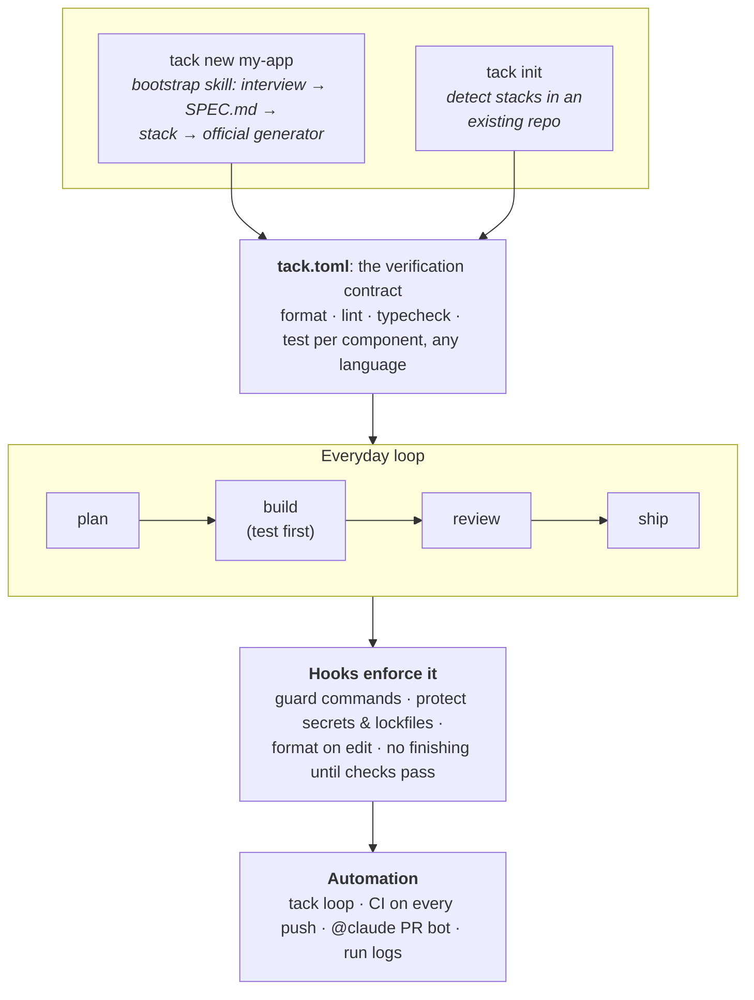

<div align="center">

# tack

**A stack-agnostic harness for AI-assisted development.**

The AI does the thinking. tack makes it consistent, safe, cheaper, automatic, and trackable,<br>
in any language, for new projects and existing ones.

[](https://pypi.org/project/tack-harness/)
[](https://github.com/Mohidkz05/tack/actions/workflows/ci.yml)
[](LICENSE)
[](pyproject.toml)
[](pyproject.toml)

</div>

---

Most agent setups *tell* the AI how to behave. tack **checks** that it did.

```console
$ tack loop "make the failing tests in tests/test_textutils.py pass"

[tack] iteration 1/3: running agent
  │ **The bug:** `slugify` in `textutils.py` only lowercased the text and turned each space into a hyphen.
  │ **The fix:** it now lowercases the text, keeps only the runs of letters and digits,
  │ and joins them with single hyphens.
[tack] iteration 1/3: verifying
  PASS     0.0s  demo:format  uv run ruff format --check .
  PASS     0.0s  demo:lint  uv run ruff check .
  PASS     0.2s  demo:test  uv run pytest -q

[tack] loop PASSED: 1 iteration(s), 40s
[tack] log: .tack/runs/20261121T054631Z-make-the-failing-tests-in-tests-test-tex.jsonl
```

*A real run with Claude Code on a project with a buggy function. If a check had failed, tack would have fed the failure output back and tried again.*

## Why not just use a plain AI?

| A plain AI coding agent... | With tack |
|---|---|
| Says "done" when it *thinks* it's done | Can't finish until the project's real checks pass (a `Stop` hook runs them) |
| Forgets everything between sessions | `PROGRESS.md` is shown at the start of every session, and Claude can't finish real work without updating it |
| Forgets which skill to use | A [playbook](https://github.com/Mohidkz05/playbook) routes it: "landing page" → your design skill, automatically |
| Usually avoids `rm -rf /`, force-pushes, and editing `.env` | **Can't** do them. Guard hooks block them before they run |
| Burns tokens formatting files and figuring out how to run your tests | Formatting runs on save; one contract tells every agent how to verify |
| Follows whatever conventions you remember to repeat | Same rules for every agent and every human (`AGENTS.md`) |
| Needs you watching | `tack loop` works unattended; CI and an `@claude` bot run on every PR |
| Leaves no record | Every loop run is logged: attempts, check results, time, cost |
| Ties you to one tool | Works with Claude Code, Codex, Cursor, Gemini, Aider, or any CLI agent |

## Quick start

```bash
# install the CLI (zero dependencies, Python 3.11+)
pip install tack-harness        # or: uv tool install tack-harness / pipx install tack-harness
```

**Start a new project.** Claude interviews you, writes the spec, picks the stack, and scaffolds it with the ecosystem's official generator:

```bash
tack new my-app
cd my-app && claude "/bootstrap"
```

**Add tack to an existing project.** It detects every language in the repo, including monorepos:

```bash
cd your-project
tack init        # writes tack.toml, AGENTS.md, CLAUDE.md, .claude/ (your own files are merged, never clobbered)
tack verify      # run every check
tack doctor      # find anything missing or misconfigured
```

**Or use it as a Claude Code plugin** (skills, subagents, and hooks with no CLI):

```text
/plugin install tack --marketplace Mohidkz05/tack
```

## How it works



### 1. One contract for every language

`tack.toml` maps a fixed set of checks onto each component's real tools. Hooks, agents, CI and `tack loop` only ever say "verify". They never need to know the stack.

```toml
[[components]]
name = "api"
path = "services/api"
stack = "python"
[components.commands]
format_check = "uv run ruff format --check ."
lint = "uv run ruff check ."
typecheck = "uv run mypy ."
test = "uv run pytest -q"

[[components]]
name = "web"
path = "web"
stack = "node"
[components.commands]
format_check = "pnpm exec prettier --check ."
lint = "pnpm run lint"
typecheck = "pnpm exec tsc --noEmit"
test = "pnpm run test"
```

Components run in parallel. `--changed` checks only the components touched since the last commit, so a 30-package monorepo verifies just what you changed. See the [manifest reference](docs/manifest.md).

| Detected automatically | From |
|---|---|
| Python | `pyproject.toml` / `requirements.txt` (uv, poetry, pip · ruff/black · mypy/pyright · pytest) |
| JavaScript / TypeScript | `package.json` (npm, pnpm, yarn, bun · prettier/biome · eslint · tsc · your scripts) |
| Go | `go.mod` (gofmt · go vet / golangci-lint · go test) |
| Rust | `Cargo.toml` (cargo fmt · clippy · cargo test), workspaces collapsed into one component |
| Java / Kotlin | `pom.xml`, `build.gradle(.kts)` (wrapper-aware, spotless) |
| Anything else | `Makefile` targets (`make lint`, `make test`, ...) |

### 2. Good habits, written down once

| Skills (`.claude/skills/`) | Subagents (`.claude/agents/`) |
|---|---|
| `plan`: short, checkable plan before non-trivial work | `reviewer`: fresh-context review, verified findings only |
| `build`: red → green → refactor, finish on green checks | `test-writer`: behavior-focused tests in the project's style |
| `review`: correctness, contract, tests, security, scope | `security-reviewer`: source-to-sink security review |
| `debug`: reproduce → root cause → fix → prove | |
| `commit`: small Conventional Commits, never `--no-verify` | |
| `ship`: full checks, review, notes, PR | |
| `bootstrap`: turn a blank repo into a verified skeleton | |

`AGENTS.md` holds the rules every agent reads (Codex, Cursor, and Gemini read it natively); `CLAUDE.md` imports it.

### 3. Guardrails that don't depend on the model behaving

| Hook | What it does |
|---|---|
| `SessionStart` | Tells the agent the components, the definition of done, and the saved `PROGRESS.md` |
| `PreToolUse` · Bash | **Denies** `rm -rf /`/`~`, force-push to main, `curl \| sh`, `dd`/`mkfs`, writes to `.env`. **Asks** before `git reset --hard`, `sudo`, `--no-verify`, publishing |
| `PreToolUse` · Edit | Blocks edits to secrets (`.env`, keys) and lockfiles (use the package manager) |
| `PostToolUse` | Formats the file that was just edited, with that component's formatter |
| `UserPromptSubmit` · `PreToolUse` | Playbook routing: points the agent at the right skill for what you asked or the file it's editing |
| `Stop` | Runs fast checks on what changed, and requires `PROGRESS.md` notes after real work. Sends the agent back (once) if either is missing |

All hooks are one stdlib-only file vendored into the project (`.claude/hooks/tack`). Teammates and CI need nothing installed, and it has no `.py` extension, so your linters and test runners never see it.

### 4. Your playbook: standard stacks and automatic skill routing

A **playbook** is a small repo with your picks: [`stacks/`](https://github.com/Mohidkz05/playbook/tree/main/stacks) (what to build with, per project type) and [`routes.toml`](https://github.com/Mohidkz05/playbook/blob/main/routes.toml) ("in this situation, use this skill"). Connect one once for your whole machine:

```bash
tack playbook use Mohidkz05/playbook     # or your fork, or a local folder
tack playbook                            # stacks, routes, and which skills you're missing
tack playbook route "make the landing page look better"
#   redesign  → redesign-existing-projects  ✓
```

From then on, in every tack project:

- **Skills are picked for you.** When what you type, or the file Claude is about to edit, matches a route, Claude is told which skill to load (once per session per route). Design routes are grouped, so only the most specific design skill fires.
- **New projects start from your stack picks.** `bootstrap` proposes the playbook's pick for the project type.
- **`tack doctor`** lists routed skills you haven't installed, and how to install them.

The [playbook repo](https://github.com/Mohidkz05/playbook) updates itself: a weekly job researches new releases and skills, and opens a PR with sources.

### 5. Automation

```bash
tack loop "add a /health endpoint with a test"   # agent → verify → feed failures back → repeat
tack loop "fix the flaky test" --agent "codex exec {prompt}" --max-iters 3
tack runs                                        # history: status, attempts, time, cost
tack add ci                                      # GitHub Actions verify workflow, set up for your stacks
tack add claude-github                           # @claude on issues/PRs + automatic PR review
```

`tack loop` works with any agent CLI: `{prompt}` is replaced with the prompt (or it goes to stdin). Runs are logged as JSONL in `.tack/runs/`. Use `--json` for machine-readable output in scripts and pipelines.

## Updates without clobbering your edits

`tack update` refreshes everything tack installed:

- **Files you haven't touched** are updated. tack tracks their hashes in `.tack/lock.json`.
- **Files you've edited** are kept and listed. Use `--force` to replace them.
- **`AGENTS.md`**: only the text between `<!-- tack:begin -->` and `<!-- tack:end -->` belongs to tack.
- **`.claude/settings.json`** is merged. Your permissions and hooks stay; outdated tack entries are removed.
- **Files tack no longer ships** are removed, unless you edited them.

The tack repo keeps itself current too. A [weekly workflow](.github/workflows/upstream.yml) checks for new Claude Code releases; Claude reads the changelog, updates tack if anything changed, runs the tests, and opens a PR. Dependabot covers the actions and dev dependencies.

## Commands

| Command | |
|---|---|
| `tack new <dir> [--start]` | New project, ready for `/bootstrap` (`--start` launches Claude Code) |
| `tack init [path]` | Add tack to an existing project |
| `tack update [--detect]` | Refresh tack's files, keep your edits; `--detect` picks up new components |
| `tack add [ci\|claude-github]` | Add an add-on (no args lists them) |
| `tack verify [--only lint,test] [-c api] [--changed] [--json\|--markdown]` | Run the checks |
| `tack loop "<task>" [--agent CMD] [-n 5]` | Let an agent work until the checks pass |
| `tack runs` | Recent loop runs |
| `tack playbook [use\|sync\|route]` | Connect, update, and test your playbook |
| `tack doctor` | Diagnose the setup |
| `tack detect [--write]` | Show detected components / merge them into `tack.toml` |

Every command that matters is also available without installing anything: `python3 .claude/hooks/tack verify | detect`.

## How tack relates to other tools

tack is deliberately small. Methodology packs like [Superpowers](https://github.com/obra/superpowers) and spec frameworks like [Spec Kit](https://github.com/github/spec-kit) and [OpenSpec](https://github.com/Fission-AI/OpenSpec) are mostly instructions for the agent. tack's focus is the **enforcement layer** underneath: a language-agnostic verification contract, hooks that block what instructions can only discourage, and automation that runs without supervision. They compose well. Use a spec framework for planning, and tack to make sure what gets built actually passes.

## Design decisions

- **The runtime is one stdlib-only file, vendored into each project.** Hooks run on every tool call, so they must start fast and work for teammates and CI without installing anything. The same file powers the CLI, and a CI check keeps the copies identical.
- **Hooks fail open, guards fail closed.** A malformed `tack.toml` or a missing tool never wedges the agent; destructive commands are denied by pattern before they run.
- **No network calls in hooks.** Playbooks are synced explicitly; hooks read only the local copy, so they stay fast and work offline.
- **Updates never clobber user edits.** Every managed file is hash-locked; edited files are kept, `AGENTS.md` uses marked blocks, and settings are merged, not overwritten.
- **One source of truth.** The Claude Code plugin is generated from the same templates `tack init` installs, and a test fails if they drift.
- **Tested against reality.** Besides 144 unit tests on three operating systems, the loop and routing were verified with real Claude Code runs, which surfaced three bugs the fake-agent tests had missed.

## Development

```bash
git clone https://github.com/Mohidkz05/tack && cd tack
uv sync
uv run pytest                      # 144 tests, run in CI on Linux/macOS/Windows × Python 3.11-3.13
uv run tack verify                 # tack checks itself
python3 scripts/build_plugin.py    # regenerate plugin/ after changing templates
```

tack is built with tack: this repo has its own `tack.toml`, hooks, skills, and `PROGRESS.md`. See [CONTRIBUTING.md](CONTRIBUTING.md) and the [roadmap](docs/roadmap/README.md).

## License

[MIT](LICENSE)
